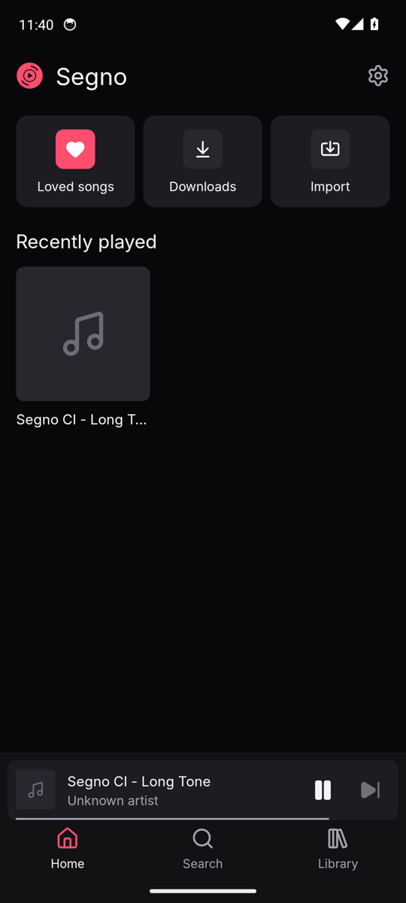
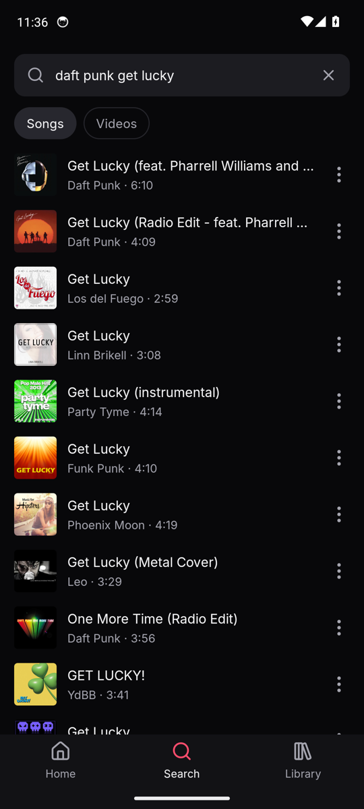
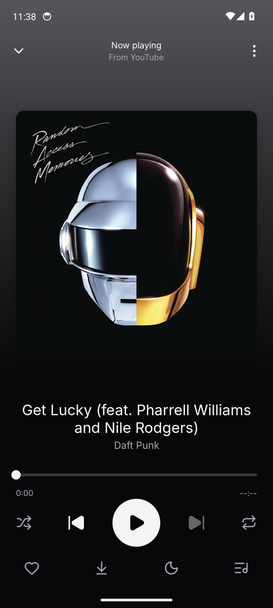
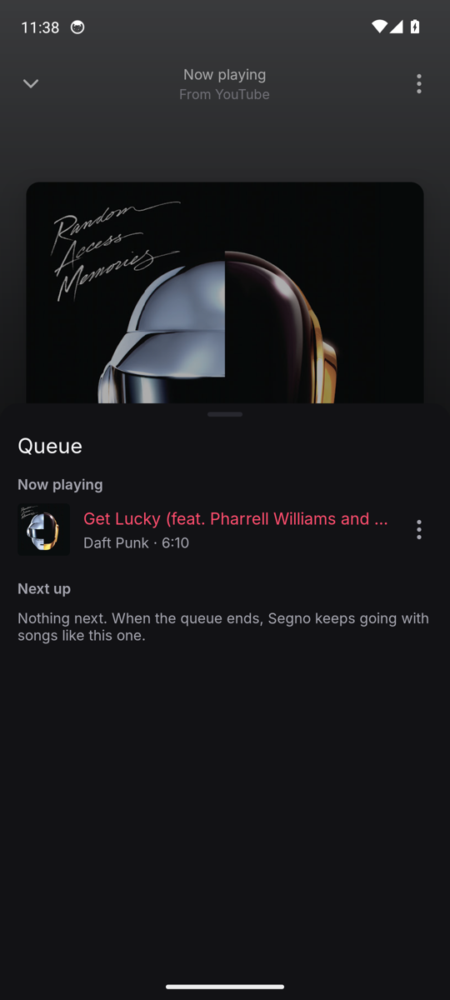
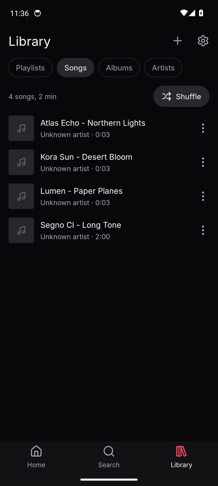
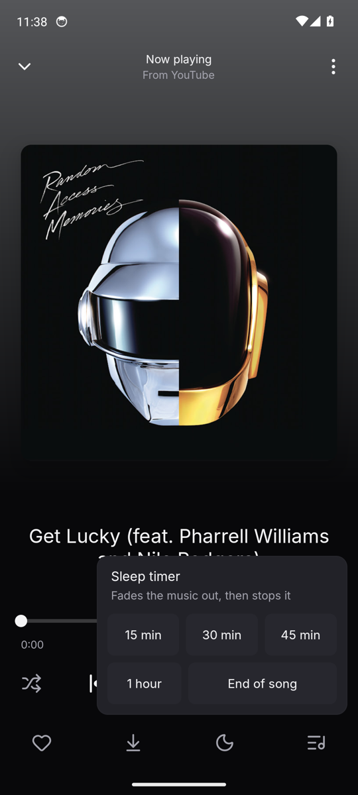
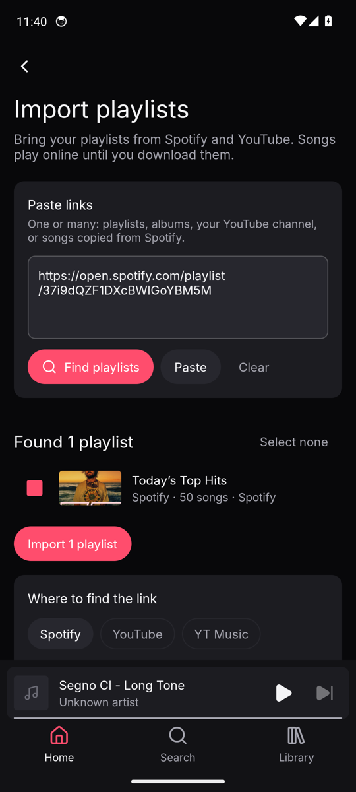
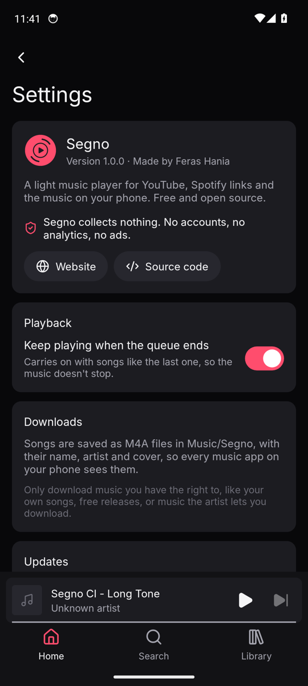

# Segno for Android

A free music player for Android. It plays YouTube, Spotify links and the music on your phone,
keeps going in the background, and runs smoothly on old and cheap phones (Android 8.0 and newer).

It's the Android version of [Segno for Windows](https://segnomusic.pages.dev), with the same
dark look and pink accent.

No account, no ads, no tracking. Segno collects nothing.

<p>
  
  
  
  
</p>
<p>
  
  
  
  
</p>

## What it does

- **Song search.** Songs from YouTube Music, with their artist and length.
  Paste a YouTube or Spotify song link and it plays.
- **Plays in the background.** Screen off, another app open: the music keeps going. Pause and
  skip from the notification, the lock screen, Bluetooth or wired headphones. Unplugging your
  headphones pauses it, and calls and other apps' sounds are handled properly.
- **Keeps going.** When the queue ends, songs like the last one follow. You can turn this off.
- **The queue.** Play next, add to queue, drag to reorder, swipe to remove.
- **Playlists and Loved songs**, kept on your phone.
- **Your music files**, by song, album and artist.
- **Downloads.** Saves songs to `Music/Segno` as M4A files with their title, artist and cover
  written into the file, so the phone's other music apps show them properly too. Progress shows
  in the app and in a notification. Downloaded songs play offline.
- **Import playlists** from Spotify (playlists, albums, songs) and YouTube (playlists, or a whole
  channel's public playlists). Spotify songs play from a YouTube video with the same length,
  skipping live versions, covers and sped-up edits unless the song itself is one.
- **Sleep timer**: 15, 30 or 45 minutes, an hour, or the end of the song. The music fades out
  over the last 30 seconds.
- **Update check**: once a day Segno asks GitHub if there's a newer version and shows a small
  note on Home. You can turn that off too.

## Install

Segno isn't on the Play Store. You install the APK from GitHub:

1. On your phone, open the [latest release](https://github.com/ferasbusiness666/segno-android/releases/latest)
   and download **Segno-x.y.z.apk**.
2. Open the downloaded file. Android asks whether your browser (or file manager) may install
   apps: tap **Settings**, turn on **Allow from this source**, then go back and tap **Install**.
   On Android 8 to 12 the switch may be called **Install unknown apps**.
3. Google Play Protect may warn that the app isn't known to it. That happens with every app
   installed from outside the Play Store. Tap **More details → Install anyway** (or
   **Install without scanning**).
4. Open Segno. When you first download a song, Android asks whether Segno may show
   notifications; say yes to see download progress.

Updates install the same way: download the new APK and open it. Your playlists and downloads
stay.

## Build it yourself

You need JDK 21 and the Android SDK (API 37).

```sh
./gradlew assembleDebug          # app/build/outputs/apk/debug/app-debug.apk
./gradlew testDebugUnitTest      # unit tests
./gradlew assembleRelease        # minified release APK
```

A release build is signed with your own key when `keystore.properties` exists in the project
folder (it's ignored by git):

```properties
storeFile=/path/to/segno-release.jks
storePassword=...
keyAlias=segno
keyPassword=...
```

Without it, release builds are signed with the debug key so you can still install them.
Debug builds use the fixed key in `app/debug.keystore` (passwords `android`), so every new test
build, including the ones from CI, installs over the last one. It isn't a secret, and the
release workflow won't sign with it.

### How it's made

- Kotlin with classic Android views (XML layouts, ViewBinding, RecyclerView). No Compose, so it
  starts fast and stays light on old phones.
- [NewPipe Extractor](https://github.com/TeamNewPipe/NewPipeExtractor) for YouTube search,
  playlists and audio. Song addresses are looked up right before a song plays (they expire after
  a few hours), looked up again if YouTube refuses one, and the next song's is fetched a little
  before it's needed.
- [AndroidX Media3](https://github.com/androidx/media) (ExoPlayer and MediaSession) for
  playback, the notification and the lock screen.
- Spotify links are read from Spotify's public embed pages, the same way as in Segno for
  Windows.
- Release builds are shrunk with R8. A small SQLite database holds playlists, loved songs and
  downloads.

### CI

Every push builds the app, runs the unit tests and lint, then installs it on Android 8.0
(API 26) and Android 14 (API 34) emulators. There it measures cold start time, takes
screenshots of each screen, searches YouTube and tries to play a song, goes to the home screen
for 30 seconds to check that the music keeps playing (with the notification), and measures
scrolling smoothness and memory. YouTube usually refuses to play to GitHub's servers ("sign in
to confirm you're not a bot"), so the CI reports that and checks background playback with a
music file instead. Results go to the
[`ci-out`](https://github.com/ferasbusiness666/segno-android/tree/ci-out) branch.

The **Release** workflow (run by hand) builds the signed APK and publishes a GitHub release
with notes from [CHANGELOG.md](CHANGELOG.md).

## License

Segno for Android is free software under the **GNU General Public License v3.0**
(see [LICENSE](LICENSE)). Copyright © 2026 Feras Hania.

It's GPL-3.0 because it uses NewPipe Extractor, which is GPL-3.0. Segno for Windows stays under
the MIT license.

Thanks to NewPipe Extractor (GPL-3.0), AndroidX Media3, AndroidX, Material Components, OkHttp,
Coil and Kotlin coroutines (Apache-2.0), Rhino (MPL-2.0), jsoup (MIT), the
[Inter](https://github.com/rsms/inter) typeface (SIL OFL 1.1) and
[Lucide](https://lucide.dev) icons (ISC). The full list with license texts is in the app under
Settings → Open-source licenses.

Only download music you have the right to, like your own songs, free releases, or music the
artist lets you download.
